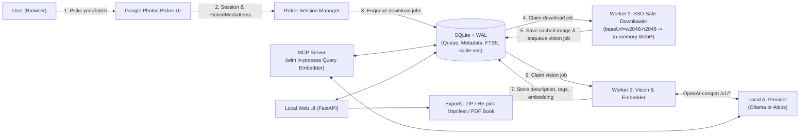

# Vision Memory Book — Architecture & Implementation Plan

> **Goal:** Build a local-first, privacy-preserving worker, MCP server, and web UI that ingests photos via the Google Photos Picker API, enriches them using local vision LLMs and embeddings (**Ollama** & **`jsilvanus/aidos`** compatible), enables curated photo grouping, and empowers a local LLM to generate a yearly memory photo book.

---

## 1. Core Constraints & Design Decisions

1. **Privacy First (Local Models):**
   - Photo bytes, generated descriptions, tags, embeddings, and book narratives never leave the user's machine for inference.
   - All VLM, text LLM, and embedding calls target local endpoints (Ollama or Aidos).
2. **Google Photos API Reality (Post-March 2025):**
   - `photoslibrary.readonly` is deprecated; the **Google Photos Picker API** (`photospicker.googleapis.com`) is used instead.
   - **No persistent remote fetch by ID:** Picker `PickedMediaItem.id` cannot be used to re-download bytes once a session/`baseUrl` expires (60 minutes).
   - **SSD-Safe Direct-Resized Download:** Instead of downloading 5–15 MB originals (`=d`), writing to SSD, thumbnailing, and deleting, Worker 1 requests resized images directly from Google (`{baseUrl}=w1024-h1024` by default, or `=w2048-h2048`), processes/converts in memory (`BytesIO`), and writes only the final cached WebP/JPEG to disk.
   - **Final-Touch Re-Pick Option (`=d` Full-Res):** Because `1024px` cached copies are fast and light for indexing/browsing, SQLite stores `picker_id`, `filename`, `create_time`, and dimensions. Once the user/LLM finalizes a group or memory book (~50–100 photos), a dedicated **Re-Pick for Final Touch** workflow exports the target checklist and opens a Picker session to fetch `=d` full-resolution originals just for those selected items before final PDF/print export.
3. **Single-Language Stack (Python 3.11+):**
   - Python provides first-class support for the official `mcp` SDK, `fastapi`, `httpx`, `Pillow`, `sqlite-vec`, and PDF generation (`weasyprint` or `typst`).

---

## 2. System Architecture



### Component Responsibilities

| Component | Responsibility |
| :--- | :--- |
| **Picker Session Manager** | OAuth2 desktop flow (`photospicker.mediaitems.readonly`), creates Picker sessions, polls `sessions.get`, paginates `mediaItems.list`, deduplicates by `picker_id`, and enqueues `download` jobs. |
| **Worker 1 (Downloader)** | Claims `download` jobs before the 60-min `baseUrl` expires. Fetches `{baseUrl}=w2048-h2048` (configurable) with OAuth bearer token, normalizes to WebP in RAM, writes to `data/cache/{year}/{id}.webp`, and enqueues `vision` job. |
| **Worker 2 (Vision + Embedder)** | Claims `vision` jobs from SQLite. Sends cached image to VLM for structured JSON (`description`, `tags`, `scene`, `subjects`), then sends `description + tags` to `/v1/embeddings`, and writes results to `photos`, `photo_tags`, `photos_fts`, and `photo_embeddings`. |
| **MCP Server** | Exposes tools over `stdio` / Streamable HTTP. Includes an **in-process query embedder** (embeds search text on demand via `/v1/embeddings` in ~10–50ms) and runs hybrid queries (date range + tags + FTS5 + vector cosine similarity). |
| **Web UI (FastAPI)** | Local dashboard for launching Picker sessions, monitoring the job queue, browsing/searching photos, managing photo groups (create, add/remove, reorder, caption), and downloading ZIPs / re-pick manifests / PDF books. |
| **Memory Book Generator** | Orchestrates a local LLM + MCP tools to cluster a year's photos into chapters, select highlights into groups, draft narratives/captions, and render a print-ready PDF. |

---

## 3. Ollama & `jsilvanus/aidos` Compatibility

Both **Ollama** and **Aidos** (per `RFC-0103`) expose OpenAI-compatible HTTP endpoints:
- `POST /v1/chat/completions`
- `POST /v1/embeddings`

### Unified Provider Adapter (`src/vision_memory_book/ai/`)
- **`OpenAICompatProvider`**: Configurable `base_url`, `api_key` (or bearer token), `vision_model`, `text_model`, `embed_model`.
- **Ollama profile**: `base_url = "http://localhost:11434/v1"`, e.g. `qwen2.5vl` (vision), `nomic-embed-text` (embeddings), `qwen2.5:14b` (book writing).
- **Aidos profile**: Reads Aidos's loopback discovery file (ephemeral port on `127.0.0.1` + loopback bearer token per `RFC-0103`), or connects to `http://127.0.0.1:18080/v1`.
  - *Note:* `RFC-0103` currently ships text LLM, embeddings, and STT first, with vision/multimodal as future work. The system supports **split-provider config** (e.g., Ollama for vision tagging + Aidos for embeddings and book generation, or Ollama/Aidos for all stages once Aidos multimodal HTTP is active).

---

## 4. SQLite Schema & Resumable Job Queue

Database runs in `WAL` mode (`PRAGMA journal_mode=WAL; PRAGMA foreign_keys=ON;`) with `sqlite-vec` and `FTS5`.

### Core Tables
1. **`picker_sessions`**: `id`, `picker_uri`, `status` (`pending|completed|expired`), `expire_time`, `created_at`.
2. **`photos`**:
   - `id` (PK), `picker_id` (UNIQUE), `filename`, `mime_type`, `create_time` (ISO-8601 UTC), `year` (indexed), `width`, `height`, `camera_make`, `camera_model`
   - `cache_path` (local WebP path), `description` (TEXT), `vlm_json` (JSON), `vlm_model`, `embed_model`, `status` (`queued|downloaded|indexed|failed`), `created_at`, `updated_at`.
3. **`photo_tags`**: `photo_id`, `tag` (normalized lowercase), `PRIMARY KEY (photo_id, tag)`.
4. **`photos_fts`** (FTS5 virtual table): indexes `description` and `tags` for fast keyword search.
5. **`photo_embeddings`** (`sqlite-vec` virtual table): stores float32 embedding vectors keyed by `photo_id`.
6. **`jobs`** (Persistent Resumable Queue):
   - `id`, `job_type` (`download|vision`), `photo_id`, `payload_json` (e.g., `base_url` + `session_expire_at` for downloads), `status` (`pending|running|done|failed|paused`), `priority`, `attempts`, `max_attempts`, `locked_by`, `locked_at`, `heartbeat_at`, `last_error`, `created_at`, `updated_at`.
   - Workers claim jobs atomically (`UPDATE ... RETURNING`) and recover stale locks if a worker crashes.
7. **`groups`**: `id`, `name`, `year`, `description`, `kind` (`manual|book_chapter`), `created_at`.
8. **`group_items`**: `group_id`, `photo_id`, `sort_order`, `caption`, `PRIMARY KEY (group_id, photo_id)`.
9. **`books`**: `id`, `year`, `title`, `outline_json`, `html_path`, `pdf_path`, `created_at`.

---

## 5. MCP Server Surface

Transport: `stdio` (for local Claude/Cursor/Aidos clients) and optional `streamable-http`.

### Tools
- **Search & Query:**
  - `search_photos(query?, start_date?, end_date?, year?, tags?, group_id?, limit=20, offset=0)` — embeds `query` on the fly and combines vector similarity + FTS5 + SQL filters.
  - `get_photo_details(photo_id)` — returns full metadata, tags, description, and group memberships.
  - `get_year_stats(year)` — counts by month, top tags, and indexing coverage.
- **Job Queue:**
  - `get_queue_status()` — counts by `job_type` and `status`, recent errors.
  - `control_queue(action: "pause"|"resume"|"retry_failed")`
  - `reprocess_photo(photo_id)` — enqueues a fresh `vision` job.
- **Groups:**
  - `list_groups(year?)`, `create_group(name, year?, description?, kind?)`
  - `add_photos_to_group(group_id, photo_ids, captions?)`, `remove_photos_from_group(group_id, photo_ids)`
  - `reorder_group(group_id, ordered_photo_ids)`
  - `get_group_photos(group_id)`
- **Book Helpers:**
  - `save_book_draft(year, title, chapters_json)` — persists structured book outline & triggers HTML/PDF rendering.

---

## 6. Repository Structure

```text
vision-memory-book/
├── docs/
│   └── plan.md
├── pyproject.toml
├── .env.example
├── src/
│   └── vision_memory_book/
│       ├── __init__.py
│       ├── config.py              # Pydantic settings (AI providers, paths, resolution)
│       ├── cli.py                 # CLI entrypoints (init-db, pick, worker, mcp, web, book)
│       ├── db/
│       │   ├── connection.py      # SQLite WAL + sqlite-vec loader
│       │   ├── schema.sql         # Tables, indexes, FTS5, triggers
│       │   ├── queue.py           # Atomic job claim, heartbeat, retry, checkpointing
│       │   └── repository.py      # CRUD for photos, tags, search, groups, books
│       ├── ai/
│       │   ├── base.py            # Abstract Vision/Text/Embedding interface
│       │   ├── openai_compat.py   # Ollama + Aidos OpenAI-compatible HTTP client
│       │   └── aidos_discovery.py # Aidos RFC-0103 loopback discovery & bearer token reader
│       ├── picker/
│       │   ├── auth.py            # Google OAuth2 Desktop flow + token refresh
│       │   └── client.py          # Picker sessions.create, sessions.get, mediaItems.list
│       ├── workers/
│       │   ├── downloader.py      # Worker 1: SSD-safe resized fetch -> WebP cache
│       │   └── indexer.py         # Worker 2: VLM description/tags + embeddings
│       ├── mcp_server/
│       │   └── server.py          # MCP tools + in-process query embedder
│       ├── web/
│       │   ├── app.py             # FastAPI app (API + Jinja2/HTMX UI)
│       │   └── templates/         # Gallery, Groups, Queue Dashboard, Book Preview
│       └── book/
│           ├── generator.py       # Local LLM + MCP-style yearly book curation
│           └── renderer.py        # HTML/CSS -> print-ready PDF (WeasyPrint/Typst)
└── tests/
```

---

## 7. Phased Implementation Plan

1. **Phase 1 — Core Foundation & SQLite Queue**
   - Initialize `pyproject.toml` (`uv`), `config.py`, `schema.sql`, `sqlite-vec` integration, and resumable `jobs` queue with tests.
2. **Phase 2 — Google Photos Picker & SSD-Safe Downloader**
   - Implement OAuth2 flow, Picker session manager, and Worker 1 (`baseUrl=w2048-h2048` -> in-memory WebP cache).
3. **Phase 3 — Local AI Providers & Vision/Embedding Worker**
   - Implement `OpenAICompatProvider` (Ollama + Aidos discovery) and Worker 2 with structured VLM prompt, tag normalization, FTS5 sync, and vector storage.
4. **Phase 4 — MCP Server**
   - Implement MCP tools for hybrid search (with on-demand query embedding), queue management, and group curation.
5. **Phase 5 — Local Web UI & Exports**
   - Build FastAPI + HTMX UI for Picker import, queue status, photo search, group curation, ZIP export, and a **Final-Touch Re-Pick** flow (generates a date/filename checklist for a finalized group/book, opens a Picker session, matches picked items by `picker_id`, and downloads `=d` originals into `data/originals/`).
6. **Phase 6 — Yearly Memory Book Generator**
   - Build the LLM-driven yearly curator (selects chapters/themes into groups, writes captions/intros) and PDF renderer (automatically preferring `=d` re-picked originals when present, falling back to cached copies).
7. **Phase 7 — Local Person Clustering & Curation (Face Recognition)**
   - Add an optional local ONNX face pipeline (`insightface` / `RetinaFace` + `ArcFace`) alongside Ollama/Aidos, with nameless-first clusters, cluster naming/merging, and persistent **"Not Person A"** exclusions.

---

## 8. Key Risks & Mitigations

| Risk | Mitigation |
| :--- | :--- |
| **Picker `baseUrl` expires in 60 min** | Worker 1 runs immediately during/after picking with high concurrency; expired `download` jobs are marked cleanly so the user can re-pick just missing items. |
| **Picker session item limit (~2,000 items)** | Process by year or half-year; deduplicate on `picker_id` in SQLite. |
| **Aidos vision endpoint not yet exposed** | Support split provider config so Ollama can run vision while Aidos runs embeddings/text, with zero code changes when Aidos adds vision. |
| **Local VLM throughput on large libraries** | Resumable SQLite queue with pause/resume, configurable image size (`1024px` sent to VLM even if `2048px` is cached), and graceful shutdown on SIGINT/SIGTERM. |

---

## 9. Phase 7 Design: Local Person Clustering & Curation

- **Inference Split:** Keep **Ollama / Aidos** for VLM, text LLM, and text embeddings (they already handle GGUF/MLC quantization, VRAM management, and OpenAI-compatible serving). Run **only face detection & 512-d ArcFace embeddings** locally via `insightface` + `onnxruntime` (~150 MB models, runs cleanly on CPU without colliding with Ollama's GPU memory).
- **Schema Extensions:**
  - `person_clusters`: `id`, `label` (defaults to `person_001`, user-editable), `cover_face_id`, `created_at`, `updated_at`.
  - `faces`: `id`, `photo_id`, `bbox_json`, `det_score`, `cluster_id` (nullable), `locked_manual` (boolean—prevents re-clustering from undoing manual edits).
  - `face_embeddings`: `sqlite-vec` `vec0` table (`FLOAT[512]`).
  - `face_exclusions`: `(face_id, cluster_id)` primary key—records **"Not Person A"** rejections so incremental matching and re-clustering never put that face back into that cluster.
- **Curation Workflows (Web UI `/people` + MCP):**
  - **Name / Rename:** Label `person_001` → `"Alice"`.
  - **Merge:** Combine multiple clusters (e.g., child vs. older photos of the same person).
  - **Remove ("Not Person A"):** Clears `cluster_id` (or moves to a chosen cluster), sets `locked_manual = 1`, and writes `(face_id, cluster_id)` to `face_exclusions`.
  - **Search & Book Curation:** Filter `search_photos(person_ids=[...])` to find solo portraits or co-occurrences (e.g., all photos with both Person A and Person B).

